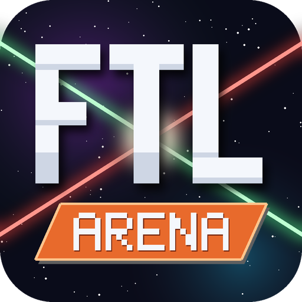
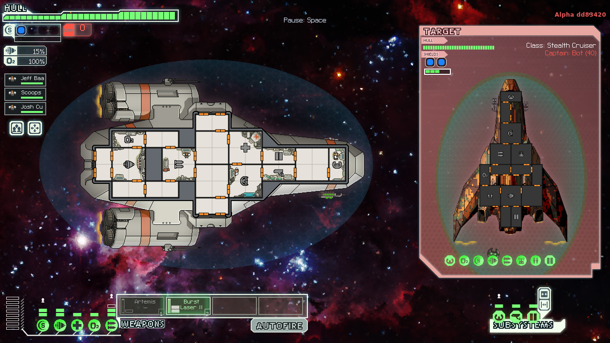
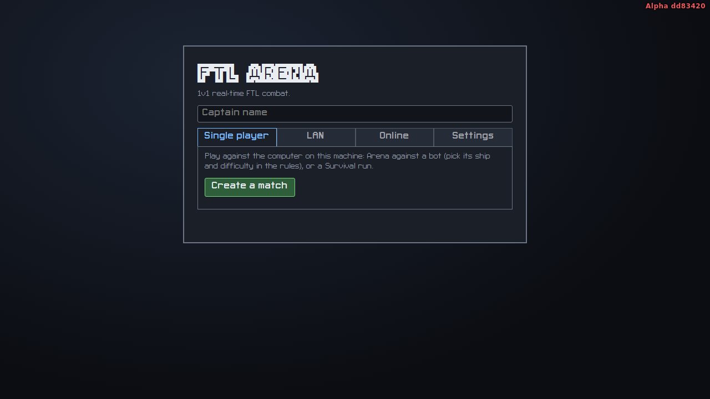
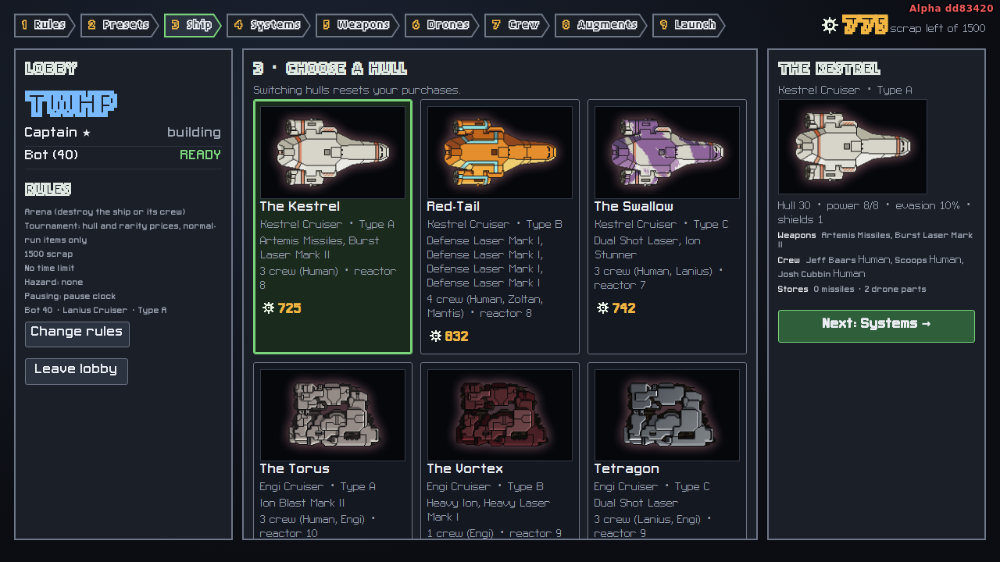
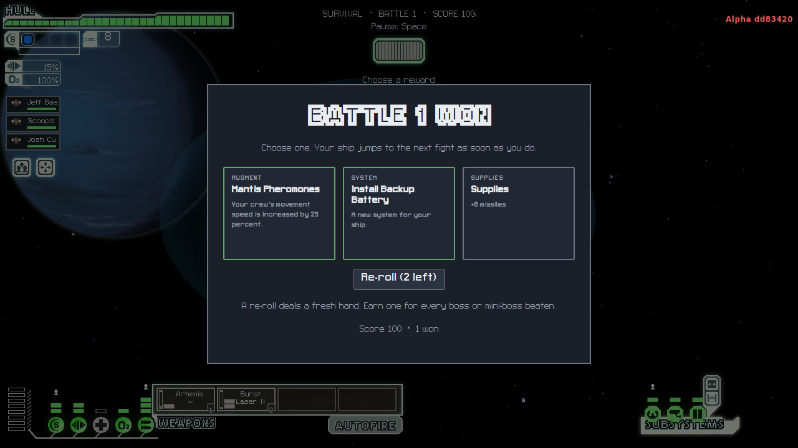
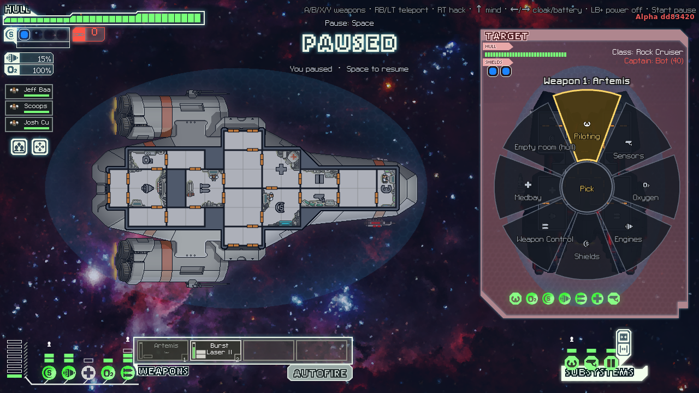
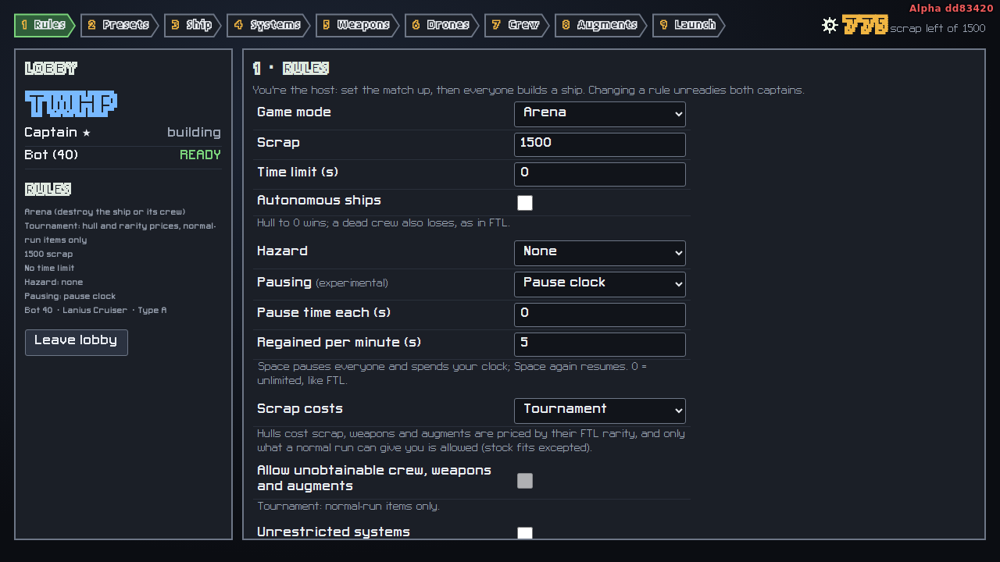

  

<h1 align="center">FTL Arena</h1>

  <b>Real-time 1-on-1 battles in the world of FTL: Faster Than Light.</b> 
  Build a ship, bring a friend, and find out whose crew holds together.

  <a href="https://github.com/dwatson251/ftl-arena/releases"><b>⬇ Download (Windows, Linux, Steam Deck)</b></a>
  &nbsp;·&nbsp; <a href="docs/PLAYING.md">Player's guide</a>
  &nbsp;·&nbsp; <a href="https://subsetgames.com/ftl.html">Get FTL</a>

> **Alpha.** This is an early playtest build. Expect rough edges, and please
> [report what you find](https://github.com/dwatson251/ftl-arena/issues).

## Why this exists
Ever since I first played FTL back in 2015, I couldn't stop thinking about one question: *what would a true
1-on-1 battle mode look like?*

While projects like Tachyons expanded the formula with new mechanics, I always wanted something that stuck
purely to the core engine, weapons, upgrades and tactical pacing of the original game.

FTL Arena is that: two captains, two ships, and FTL's rules.

## Features
- **1v1 multiplayer**, on your network (share a 4-letter code) or over the internet. Host from the app, or
  run the dedicated server.
- **FTL's combat, faithfully:**
  - every system, weapon, drone, augment and crew race;
  - all 28 player cruisers;
  - fires, breaches, boarding, hacking, mind control and cloaking, with FTL's own numbers.
- **The hangar:** spend a scrap budget on a hull, systems, weapons, drones, crew and augments, step by
  step. Save your favourite builds as presets.
- **Load from FTL:** bring the ship from your current FTL run straight into the arena.
- **Single player:**
  - fight a bot at any difficulty from 0 to 100, flying any cruiser, a single-player enemy or the Rebel
    flagship;
  - or play **Survival**: battle after battle, picking upgrades between jumps, with mini-bosses every 5
    fights and the flagship at 25.
- **Rules your way:**
  - win by destroying the ship or by killing the crew;
  - time limits, hazards and pause rules;
  - scrap-cost modes, including **Tournament**: rarity prices, and only items a normal run can give you.
- **Controller support** (experimental): selector wheels for aiming and boarding, while the AI handles the
  crew. Works with Xbox, PlayStation and Steam controllers, and on the **Steam Deck**.

| | |
|---|---|
|  |  |
|  |  |
|  | |

## You need FTL
FTL Arena runs on **your own copy of FTL: Faster Than Light** (version 1.6 or later, from Steam, GOG or Humble).
On first start, the app reads the ships, art, sound and music from your install. None of FTL's files come
with the download.

Don't have it? [Buy FTL from Subset Games](https://subsetgames.com/ftl.html). It's a great game.

## Download and play
1. Get the latest build from the [**releases page**](https://github.com/dwatson251/ftl-arena/releases):

   | Platform | File |
   |---|---|
   | Windows | `FTL-Arena-win-x64.zip` |
   | Linux | `FTL-Arena-linux-x64.tar.gz` |
   | Steam Deck (or any Linux) | `FTL-Arena-x86_64.AppImage` |
   | Dedicated server | `FTL-Arena-Server-*` |
2. **Run it:**
   - **Windows:** unzip the folder anywhere and run `FTL Arena.exe`. The app isn't signed, so Windows may
     warn you: choose *More info → Run anyway*.
   - **Steam Deck:** in Desktop Mode, mark the AppImage executable, then add it to Steam as a non-Steam game
     ([details](docs/PLAYING.md#steam-deck)).
3. **First start:** point the app at your FTL folder. It finds Steam installs by itself.
4. **Play:**
   - **Single player → Create a match** to practice.
   - To play a friend, use **LAN** or **Online** ([how](docs/PLAYING.md#hosting-and-joining)).

The [player's guide](docs/PLAYING.md) covers the controls, the hangar, every game mode, and hosting.

## Made with AI
FTL Arena is built with the help of AI coding agents (Anthropic's Claude, through Claude Code). The agents
write most of the code, while the game design, playtesting and direction come from a human. The development
journal is in [docs/MODLOG.md](docs/MODLOG.md).

## For developers
[docs/DEVELOPMENT.md](docs/DEVELOPMENT.md) covers building from source, the architecture, the tests and the
release process.

## Credits and notice
- **Not official:** FTL: Faster Than Light is © Subset Games. FTL Arena is an unofficial fan project, **not
  affiliated with or endorsed by Subset Games**.
- **No FTL files:** it includes none of FTL's game files. Everything from FTL comes from your own copy. The
  screenshots and the icon show FTL's art.
- **Sources:** combat numbers come from the [FTL wiki](https://ftl.fandom.com) and FTL's own blueprints (see
  [docs/RULES.md](docs/RULES.md)). The data-file layout was cross-checked against the community's notes
  (Slipstream Mod Manager).
- **Built with** Pixi.js, Electron, ws, Vite, vitest and Playwright.
